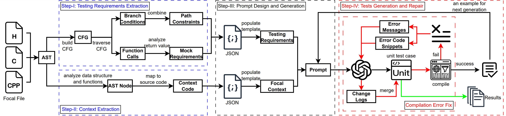
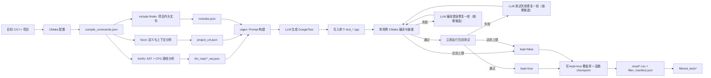
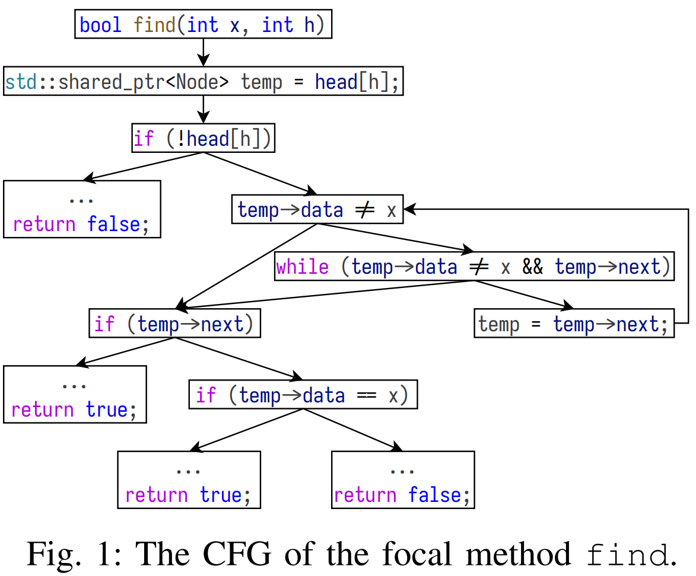
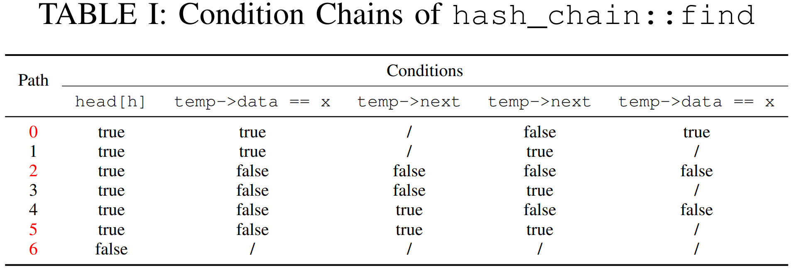
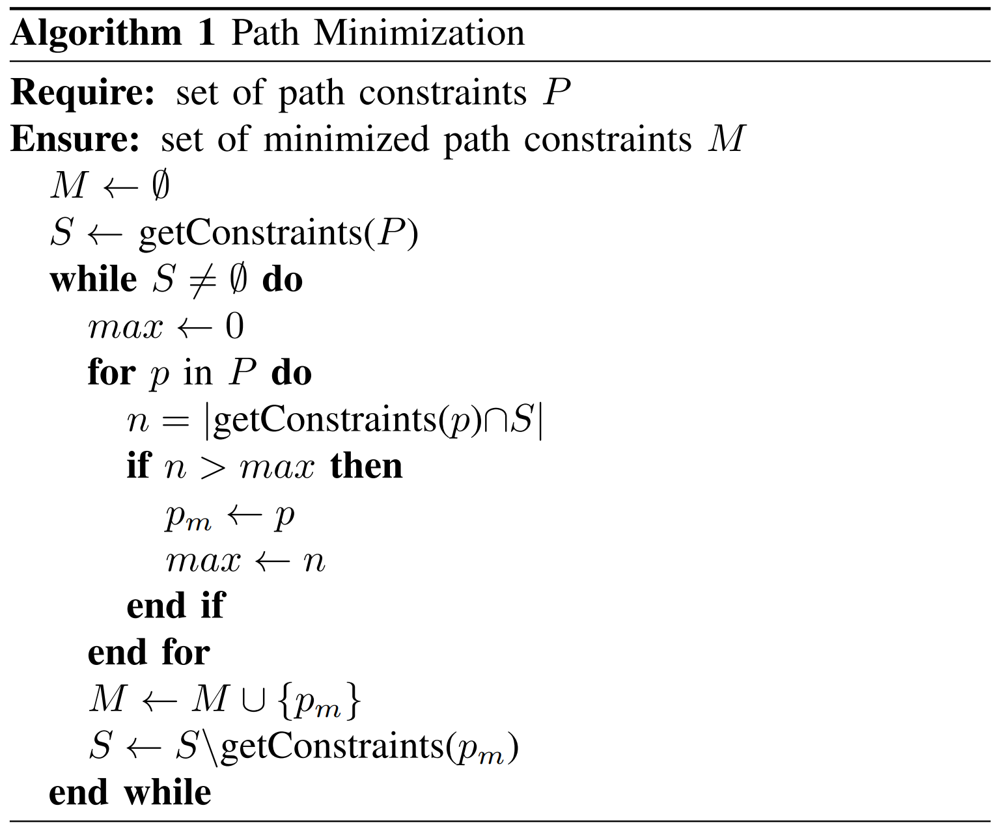
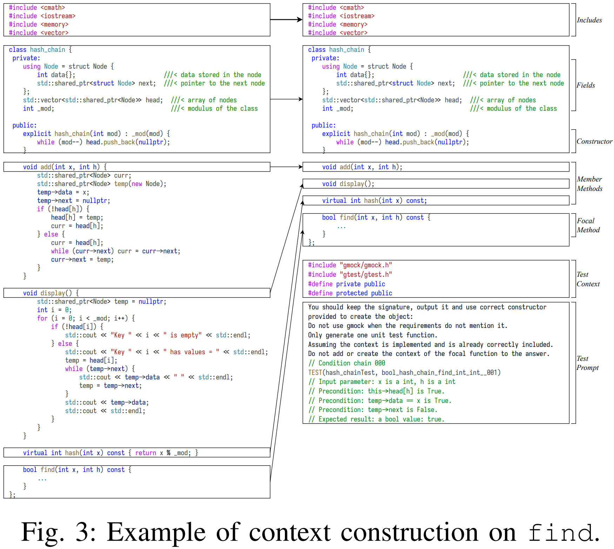
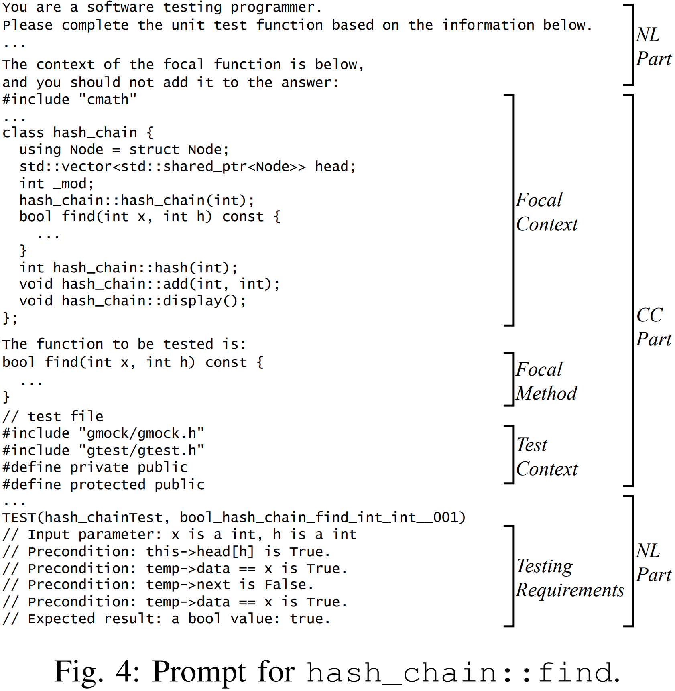
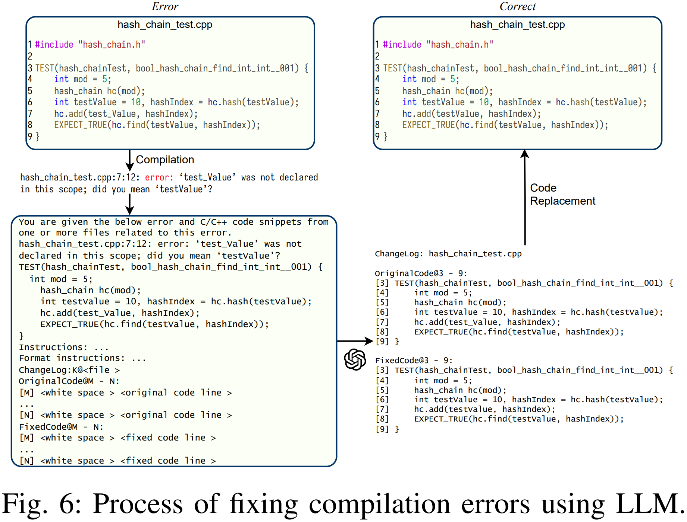

# 基于大模型的 C/C++ 单元测试生成说明与运行指南

本文说明本项目面向 C/C++ 项目的 PALM 单元测试生成流程，包括技术路线、核心概念、模块职责、数据流、输出产物和运行步骤。

## 1. 项目目标

本项目面向 C/C++ 项目自动生成 GoogleTest/GoogleMock 单元测试。核心目标是：在给定被测函数的路径约束、上下文代码和必要 Mock 需求后，利用大语言模型生成更容易通过编译、覆盖更多路径的单元测试用例，并通过编译错误反馈对失败测试进行迭代修复。

C/C++ 单元测试生成相比只给源码片段的普通代码生成有几个典型难点：

- 编译环境复杂：头文件、宏、编译选项、链接目标、CMake 构建目录和编译数据库都会影响测试是否可编译。
- 依赖上下文复杂：被测函数可能依赖类成员、构造函数、析构函数、继承关系、模板实例、全局变量、别名、命名空间和其他函数。
- 路径约束隐含：模型只看函数源码时，容易遗漏复杂分支、循环、`switch`、短路逻辑和返回值路径。
- Mock 需求难判断：路径上的函数调用可能决定分支条件，模型需要知道哪些类方法或自由函数要用 gMock 构造期望行为。
- 结果统计依赖构建系统：测试生成后需要逐个编译、运行并收集行覆盖率和分支覆盖率。

PALM 的整体思路是把程序分析结果纳入 Prompt 构建过程：先用 Clang Tooling 提取条件链和 Mock 需求，再构建被测函数上下文，随后让 LLM 按路径生成测试，并用 CMake/CTest/覆盖率工具验证生成结果。

## 2. 总体技术路线



整体流程可以概括为四步：

1. 测试需求提取：`brinfo` 基于 Clang AST 构建被测函数 CFG，遍历分支和循环路径，提取路径条件链、返回值和 Mock 需求，输出 `llm_reqs/*_req.json`。
2. 上下文构建：`focxt` 分析项目中的类型、函数、宏、include、全局变量、构造函数、方法和调用依赖，输出 `project_cxt.json`。
3. Prompt 设计与生成：`utgen` 读取条件链和上下文，将其填充到 Prompt 模板中，形成无需求、上下文增强、需求增强、需求+上下文增强四类生成配置。
4. 单元测试生成、筛选与修复：`utgen` 每生成一个 GoogleTest 文件，就立即为该文件建立独立目标并执行编译、编译修复、运行和测试修复；单测试默认最多共享 10 轮修复，每轮最多按需请求并验证 3 个候选。处理中状态原子写入临时 checkpoint，终态合并到 `filter_manifest.json`；最终只保留编译和运行均通过且实际执行了测试的文件统计覆盖率并导出到 `filtered_tests*`。



## 3. 核心概念

### 3.1 条件链

条件链是被测函数某一条执行路径上的约束集合。`brinfo` 通过 Clang CFG 遍历路径，在遇到 `if`、三目表达式、逻辑二元表达式、`switch/case/default`、`for/while/do while/range-for` 等控制流节点时记录路径条件；当到达出口基本块时，将沿途条件按顺序组合成一条条件链。





`llm_reqs/<file>_req.json` 中每个函数会包含：

| 字段 | 说明 |
| --- | --- |
| `name` | 函数或方法名。 |
| `namespace` | 函数所在命名空间，后续用于生成 `using namespace`。 |
| `operator` | 是否为重载运算符；主流程会跳过重载运算符。 |
| `decl_file` | 函数声明或定义所在文件的真实路径。 |
| `class` | 所属类名；自由函数为空字符串。 |
| `loc` | 函数在源文件中的起止行号。 |
| `input` | 参数名和参数类型描述。 |
| `chains` | 条件链集合。 |

每条条件链通常包含：

| 字段 | 说明 |
| --- | --- |
| `preconditions` | 路径上的前置条件列表。每个条件包含 `condition`、`value` 和 `last_def`。 |
| `mock` | 路径上与条件相关的函数调用及其 Mock 需求。 |
| `result` | 路径返回值提示，例如 `a bool value: true`。 |
| `mincover` | 是否属于最小覆盖路径集合。 |
| `incatch` | 是否来自 try/catch 相关路径。 |

### 3.2 路径最小化

一个函数的路径数量会随分支数量增长而快速膨胀。`brinfo` 使用贪心集合覆盖近似算法选择代表路径：

1. 收集所有非矛盾条件链覆盖到的条件集合。
2. 每轮选择能覆盖最多未覆盖条件的路径。
3. 将该路径加入最小覆盖集合，并移除它覆盖的条件。
4. 重复直到所有条件都被覆盖，或没有可继续选择的路径。



在 Python 主流程中，只有 `mincover = true` 的条件链会被用于按路径生成测试。当前实现不限制函数的条件链总数，但仍会跳过最小覆盖路径过多的函数：

```python
MAX_MIN_COVER = 20
```

也就是说，主流程处理最小覆盖路径数量不超过 20 的非重载运算符函数；条件链较少的简单函数也会进入生成流程。

### 3.3 Mock 需求

Mock 需求来自条件链路径上的函数调用。`brinfo` 会记录路径中出现的 `CallExpr` 和 `CXXMemberCallExpr`，并判断该调用是否直接影响某个条件约束或变量定义。

对每个需要 Mock 的调用，JSON 中会记录：

| 字段 | 说明 |
| --- | --- |
| `function` | 被调用函数名。 |
| `return` | 返回类型；`void` 时为空。 |
| `return_ref` | 返回值是否为引用类型，用于提示 `testing::ReturnRef()`。 |
| `static` | 是否为静态函数。 |
| `virtual` | 是否为虚函数。 |
| `user` | 被调用函数是否来自项目源码。 |
| `actions` | 该调用需要满足的条件效果，例如某次调用后某个条件为真。 |

`utgen/condchain.py` 会把这些结构转成自然语言测试需求。例如：

```text
// Mock SomeClass::foo which returns a int.
// It is a non-static function, you should mock it like Example A.
// It should be called 1 time(s) with the following effect(s): ...
```

目前生成侧主要支持对项目内虚成员函数生成 gMock mock class；自由函数和静态函数的 Mock 提示保留在 Prompt 设计中，但生成质量依赖模型和具体项目结构。

### 3.4 上下文

上下文用于让 LLM 知道如何构造可编译的测试。`focxt` 会从 AST 中提取被测函数及其依赖的代码片段，并输出到 `project_cxt.json`。



上下文主要包括：

- 当前文件中的 `#include`。
- 项目内定义的宏。
- 全局变量和命名空间。
- 类型别名。
- 类、结构体、union、enum 的定义。
- 字段、基类、构造函数、析构函数和成员方法。
- 自由函数定义或声明。
- 模板参数和已有特化参数提示。
- 被测函数直接或间接使用的类型和函数依赖。
- 已有测试宏，可选用于 ChatTester 或测试上下文增强。

`utgen/context.py` 会进一步把 JSON 结构转成 Prompt 中可读的 C/C++ 代码片段，例如：

- `FocalCxt`：被测函数上下文，包括 include、define、namespace、类型、函数和方法。
- `TestCxt`：已有测试上下文，包含可能可复用的 `TEST` 宏片段。
- `RecordCxt`、`EnumCxt`、`NameSpaceCxt`：分别负责格式化类/结构体/枚举/命名空间中的内容。

### 3.5 Prompt 结构



主流程会生成四类测试目录，对应四种 Prompt 配置：

| 测试类型 | 目录 | 条件链需求 | 上下文 |
| --- | --- | --- | --- |
| 原始 GPT | `llm_tests` | 否 | 否 |
| 上下文增强 | `llm_tests_cxt` | 否 | 是 |
| 需求增强 | `llm_tests_req` | 是 | 否 |
| 需求+上下文增强 | `llm_tests_req_cxt` | 是 | 是 |

对 `*_req*` 类型，`Function.gen_req_list()` 会为每条 `mincover` 条件链生成一个测试签名和需求块，例如：

```cpp
TEST(SomeClassTest, bool_SomeClass_find_int_int_001)
// Input parameter: x is a int, h is a int
// Precondition: this->head[h] is True.
// Precondition: temp->data == x is True.
// Expected result: a bool value: true.
```

每条条件链的 Prompt 明确要求一次只返回一个测试。主流程先请求并立即检查第一个候选；
只有该候选被过滤时才请求下一个，通过后立即停止，因此每条条件链实际生成 1 至 3 个
候选，硬上限为 `MAX_TESTS_PER_CONDITION_CHAIN = 3`。这个生成上限与修复阶段的
`--repair-choices` 是两个独立概念。

对不含 `req` 的类型，模型会被要求尽可能生成覆盖行和分支的多个测试；随后 `utgen` 会用 libclang 解析模型返回内容，将多个 `TEST` 函数拆分成多个独立 `.cpp` 文件。

### 3.6 编译错误修复



项目中有两类底层编译修复实现和一个面向当前流程的命令行入口：

- `chattester.py`：借鉴 ChatTester 思路，先让模型推断函数意图并生成基础测试，再用编译错误中的 `<Buggy Line>` 迭代生成完整修复版测试文件。
- `rust_assistant.py`：名称是历史遗留，实际用于 C/C++ GoogleTest 编译错误修复。它读取编译器 JSON 错误、抽取相关源码片段，要求模型返回 `ChangeLog`，再验证并应用修改。
- `compile_repair.py`：面向当前流程新增的命令行入口，优先读取 `filter_manifest.json` 并只修复 `compile=fail` 的测试；缺少 manifest 时会退回到 `rust_assistant.py` 的全量扫描逻辑。脚本会重新执行编译命令确认结果，避免把历史 `.refined` 标记误当作真实修复成功。

当前 ChangeLog Prompt 要求首行、文件名、行号和 OriginalCode/FixedCode 顺序明确。
解析器可以容忍代码围栏、空白、大小写和常见连字符差异，但不会猜测修改：目标文件
必须匹配，原始代码必须仍与磁盘内容一致，尾部插入必须连续。每轮修复按需请求候选，
解析或安全校验失败时会把格式原因反馈给下一次请求；只有可安全应用的候选才触发构建，
已经验证过的重复修改会跳过。编译器 error/note 的可读源码位置会连同末行加入 Prompt；
`<scratch space>` 等不可读取的 Clang 伪路径会跳过，不再中断修复。

`rust_assistant.py` 需要目标项目启用编译错误 JSON 输出：

```cmake
add_compile_options(-fdiagnostics-format=json-file)
```

该配置会影响 ChatTester，因为 ChatTester 的错误解析依赖标准输出中的编译错误文本。

### 3.7 运行失败修复

`test_repair.py` 用于修复已经通过编译但运行失败的生成测试。默认在线流程直接调用其中的单轮修复接口；独立运行该脚本时，它读取 `llm_tests*/filter_manifest.json` 中 `compile=pass` 且 `run=fail` 或 `run=timeout` 的记录，为每个失败测试构造一个诊断式 Prompt，输入包括：

- GoogleTest/运行失败日志。
- 当前可编辑的 `test_*.cpp`，带行号。
- 同目录 `include.h`，只读。
- 被测函数所在源文件的上下文片段，来源于 manifest 中的 `source_path` 和 `loc`。
- 原测试文件中嵌入的条件链需求注释。
- 上一轮候选修复失败日志。

Prompt 明确要求模型只修改当前 `test_*.cpp`，并禁止删除 `TEST`、删除被测函数调用、使用 `GTEST_SKIP`、替换为空断言、吞掉异常或屏蔽崩溃。模型仍然使用 `ChangeLog` 格式返回修改；脚本会先确认 ChangeLog 目标文件就是当前测试，再做静态规则检查，然后临时写入候选、重新构建并运行。每轮最多按 `--repair-choices` 逐个请求候选，前一候选不通过才请求下一个。只有候选满足 `compile pass && run pass` 时才会写回原测试并标记 `kept=true`，失败候选或验证异常会回滚并记录到 `repair_log`。

## 4. Workspace 结构

| 路径 | 作用 |
| --- | --- |
| `README.md` | 项目顶层使用流程概述。 |
| `基于大模型的C_C++单元测试生成v2.pptx` | 技术方案和实验汇报 PPT；本文只抽取技术方案图片。 |
| `docs/` | 本次生成的中文说明文档和图片资产。 |
| `analysis-tools/` | 可直接链接已安装 LLVM/Clang 17 开发包的独立 CMake 工程，不需要完整 LLVM 源码树。 |
| `analysis-tools/brinfo/` | 条件链、路径约束、返回值和 Mock 需求提取工具。 |
| `analysis-tools/focxt/` | 上下文构建工具，提取类型、函数、宏、include 和依赖代码。 |
| `analysis-tools/include-finder/` | 项目内 include 提取工具，输出 `includes.json`。 |
| `utgen/` | Python 编排层，负责项目预处理、分析调用、Prompt 构建、测试生成、CMake 写入、编译和覆盖率统计。 |
| `pyproject.toml`、`uv.lock` | Python 3.12 运行环境和完整依赖锁。 |
| `utgen/main.py` | 项目级主入口。 |
| `utgen/decldef.py` | 基于 `clang-scan-deps` 和 `clangd-indexer` 构建源文件依赖关系。 |
| `utgen/utgen.py` | 核心 Project/SourceFile/Function 对象和测试生成逻辑。 |
| `utgen/condchain.py` | 将 `brinfo` JSON 条件链和 Mock 需求转成 Prompt 文本。 |
| `utgen/context.py` | 将 `focxt` JSON 上下文转成 C/C++ 上下文片段。 |
| `utgen/expt.py` | 编译通过率、运行通过率、行覆盖率、分支覆盖率统计。 |
| `utgen/case_runner.py` | 单测试增量构建会话；为当前测试生成稳定 CMake 目标，并提供构建、运行和日志结果。 |
| `utgen/case_workflow.py` | 逐用例编译/运行/修复状态机、总轮数控制、原子 manifest 和断点续跑。 |
| `utgen/chattester.py` | ChatTester 风格基线和简单编译修复流程。 |
| `utgen/rust_assistant.py` | 基于编译器 JSON 错误和 ChangeLog 的编译修复助手。 |
| `utgen/compile_repair.py` | 编译修复命令行入口，封装历史 `rust_assistant.py` 能力。 |
| `utgen/test_repair.py` | 运行失败修复命令行入口，针对 `run_fail`/`timeout` 测试做 LLM 修复和机器验证。 |
| `utgen/prompt.py` | 测试生成、ChatTester、编译修复和运行失败修复 Prompt 模板。 |
| `utgen/config.py` | 默认配置项；实际使用建议创建 `config_private.py`。 |
| `utgen/CodeCoverage.cmake` | 覆盖率 CMake 辅助脚本，应复制到目标项目的 `cmake/` 目录。 |

## 5. `brinfo` 模块说明

`brinfo` 是测试需求提取模块，构建在 Clang LibTooling 之上。它读取 `compile_commands.json`，对指定源文件中的函数或方法构建 CFG，并输出条件链 JSON。

### 5.1 入口和命令行

入口文件是 `analysis-tools/brinfo/BrInfo.cpp`。主要参数包括：

```text
brinfo --project <project-path> -p <build-path> [--cfg] [-f <function>] [-c <class>] <source>
```

| 参数 | 说明 |
| --- | --- |
| `--project` | 目标项目根目录，用于写入 `llm_reqs/` 和 CFG dot 文件。 |
| `-p` | CMake build 目录，要求其中存在 `compile_commands.json`。 |
| `<source>` | 要分析的源文件。当前入口要求一次只指定一个源文件。 |
| `-f` | 只分析指定函数或方法。 |
| `-c` | 与 `-f` 搭配，限定所属类。 |
| `--cfg` | 输出 CFG dot 图。 |

### 5.2 函数筛选

`Matcher.h` 中的 `FuncAnalysis` 使用 AST Matcher 查找函数定义。项目级分析时会：

- 跳过名称为空的函数。
- 跳过名称中包含 `main` 或 `test` 的函数。
- 只处理正在分析的源文件中的函数。
- 跳过构造函数、析构函数和 lambda。
- 为每个函数构建 `CFG::buildCFG`，并设置 `PruneTriviallyFalseEdges = true`。

当指定 `-f` 时，工具可以只分析自由函数；当同时指定 `-c` 时，可以只分析某个类中的方法。

### 5.3 CFG 路径遍历

核心实现在 `Analysis.cpp`：

1. `Analysis::init` 去重函数位置，初始化入口块的空条件链。
2. `extractCondChains` 从 CFG 入口块开始遍历，并额外处理 try block。
3. `dfsTraverseCFGLoop` 维护显式栈，避免递归过深。
4. 遇到条件终结符时，根据后继边记录条件取值。
5. 遇到出口基本块时，将路径和条件序列保存为 `CondChainInfo`。

支持的控制流包括：

- `if`、二元逻辑表达式、三目表达式。
- `switch`、`case`、`default`。
- `for`、`while`、`do while`、range-for。
- `break`、`continue`、`goto`。
- try block 入口路径。

为了避免路径爆炸，`MaxChains` 限制为 1000。超过限制的函数不会继续生成需求。

### 5.4 条件规范化与矛盾检查

`Condition.cpp` 和 `CondChain.cpp` 负责把 AST 条件转为 Prompt 中可读的条件：

- 将 `a != b` 规范化为 `a == b` 并翻转布尔含义。
- 将 `!expr` 规范化为 `expr` 并翻转布尔含义。
- 对逻辑 `&&` 和 `||` 做局部条件化简。
- 对 `switch case` 生成 `cond == case`。
- 对 `default` 生成不等于所有 case 的条件组合。
- 回溯局部变量最后一次定义，记录 `last_def`。
- 将直接参数引用记录为输入参数约束。
- 检查同一条件在同一路径中是否出现相互矛盾的取值。

### 5.5 Mock 需求生成

`CondChainInfo::findCallExprs` 会遍历路径上所有 CFG 语句，收集直接调用。随后 `findContra` 会判断调用是否与条件、变量初始化或赋值有关，并将约束写入 `FuncCallInfo`。

最终 `toTestReqs` 会把函数调用转成 JSON 中的 `mock` 节点，包含函数名、类名、所在文件、是否虚函数、是否静态函数、是否项目内函数、返回类型、返回引用类型和调用效果。

### 5.6 输出产物

项目级运行后，`brinfo` 在目标项目中生成：

| 输出 | 说明 |
| --- | --- |
| `llm_reqs/<file>_req.json` | 指定源文件内所有可分析函数的条件链和 Mock 需求。 |
| `llm_reqs/<class>_<function>_req.json` | 指定函数/方法模式下的输出文件名。 |
| `*.dot` | 使用 `--cfg` 时生成的 CFG dot 图。 |

## 6. `focxt` 模块说明

`focxt` 是上下文构建模块。它同样基于 Clang LibTooling，但关注的是源码定义和依赖，而不是路径约束。

### 6.1 入口流程

入口文件是 `analysis-tools/focxt/Focxt.cpp`。主要参数包括：

```text
focxt --project <project-path> --build <build-path> [--file <source>] [--class <class>] [--function <function>] [--may-test] [--must-test <test-name>]
```

项目级运行流程：

1. 解析 `--project` 和 `--build` 的真实路径。
2. 从 `compile_commands.json` 读取实际翻译单元，并排除文件名或目录名包含 `test`、目录名包含 `build` 的条目，与 Python 主流程的源文件筛选保持一致。
3. 若 `<project>/includes.json` 存在，合并 `include-finder` 收集的项目内头文件；所有路径会规范化、限制在项目根目录内并去重排序。不会递归分析仓库中未参与目标构建的示例或工具源码。
4. `GetClassesAndFunctions` 扫描项目内类、结构体、枚举、函数、模板和调用依赖。
5. `GetFileContext` 为每个文件构造函数级上下文。
6. 输出 `project_cxt.json`。

### 6.2 定义扫描

`GetAllDefinition.h/.cpp` 中的 `ClassesAndFunctions` 保存项目全局定义信息，包括：

- `Class`：class/struct/union/enum 的统一表示。
- `Function`：自由函数。
- `Constructor`、`Destructor`、`Method`：类相关函数。
- `Alias`：类型别名。
- `Application`：某个类型或函数依赖的其他类型和函数。

定义扫描会提取：

- 类名、结构体名、union 名、枚举名。
- 基类、字段、别名、枚举常量。
- 模板参数和特化参数。
- 构造函数、析构函数、成员方法和自由函数的签名与函数体。
- 函数体中调用的函数和使用的变量类型。

`GetSignature.cpp` 提供统一的函数签名生成逻辑。签名会包含返回类型、类名、函数名和参数类型，用作 `brinfo` 和 `focxt` 与 Python 层对齐的关键标识。

### 6.3 文件上下文构建

`GetAllContext.cpp` 中的 `FileContext` 对单个文件收集上下文：

- `get_includes`：读取源文件中的 `#include`。
- `get_defines`：通过 `PPCallbacks` 收集项目内宏定义。
- `get_global_vars`：收集全局变量及其命名空间和类型依赖。
- `get_test_macros`：可选收集已有 `TEST` 宏。
- `get_context`：找出文件内函数和方法。
- `get_j`：为每个函数构造 `focal` 上下文 JSON。

正常项目级流程会先运行 `include-finder`，因此编译数据库未单独列出的项目头文件仍会进入上下文分析。直接运行 `focxt` 时若省略 `includes.json`，输出只覆盖编译数据库中的翻译单元。

最终 `project_cxt.json` 的顶层结构是源文件绝对路径，每个源文件下按函数或 `Class::method` 分组，每个分组下包含 `focal` 字段：

```json
{
  "/path/to/source.cpp": {
    "ClassName::method": {
      "focal": {
        "return_type ClassName::method(params)": {
          "includes": [],
          "defines": {},
          "function_body": "...",
          "namespace": {
            "class": {},
            "struct": {},
            "enum": {},
            "function": {}
          }
        }
      }
    }
  }
}
```

### 6.4 输出产物

| 输出 | 说明 |
| --- | --- |
| `project_cxt.json` | 项目级上下文信息，供 Python 主流程加载。 |

## 7. `include-finder` 模块说明

`include-finder` 通过 Clang 预处理器回调收集项目内 include 文件。

入口文件是 `analysis-tools/include-finder/IncludeFinder.cpp`。它监听 `InclusionDirective`，当 include 文件真实路径位于目标项目根目录下时，将其加入集合并输出：

```text
<project>/includes.json
```

Python 层的 `utils.collect_includes` 会在 `Project.__get_source_files` 中调用它。这样即使某些项目头文件没有直接出现在 `compile_commands.json` 中，也能被加入后续分析候选文件。

## 8. `utgen` 模块说明

`utgen` 是项目级编排层，负责从分析结果到测试文件、CMake 目标和 CSV 结果的完整流程。

### 8.1 主入口

`utgen/main.py` 支持：

```text
uv run --frozen python utgen/main.py -p <project-path> -b <build-path> [-t <type>] [--no-analysis] [--post-analysis] [--compile-only] [--test-only] [--export-only] [--batch-workflow] [--max-repair-rounds N] [--repair-choices N] [--test-timeout N] [--coverage-sonarqube-only] [--coverage-unity] [-s <source>] [-c <class>] [-f <function>]
```

默认启用逐用例在线流程。`--max-repair-rounds` 设置编译修复和测试修复共享的总轮数，默认 10；`--repair-choices` 设置每轮最多按需请求并验证的候选数，默认 3；`--test-timeout` 设置单测试运行超时，默认 600 秒。`--coverage-sonarqube-only` 省略逐函数 lcov info/HTML，只保留统计所需 SonarQube XML；`--coverage-unity` 尝试把符合安全条件的同函数测试合并编译，并自动回退逐文件目标。`--batch-workflow` 可回退到历史的全部生成后统一检查流程。`-s/-c/-f` 会进入参数对象，但当前 `main.py` 没有基于它们切换单文件或单函数流程；单函数分析应直接调用底层 `brinfo` 和 `focxt`。

`-t/--test-type` 可重复指定，命令行名称与内部目录后缀的映射为：

| 参数值 | 内部后缀 | 测试目录 |
| --- | --- | --- |
| `base` | 空字符串 | `llm_tests` |
| `cxt` | `_cxt` | `llm_tests_cxt` |
| `req` | `_req` | `llm_tests_req` |
| `req-cxt` | `_req_cxt` | `llm_tests_req_cxt` |

省略 `-t` 时处理全部四类。例如，`-t req -t req-cxt` 只处理需求增强和需求与上下文增强两类。

正常运行时流程如下：

1. `project.prepare(test_types, just_load=False)`
2. 如未指定 `--no-analysis`，执行 `project.analyze()`
3. `project.init_data()`
4. 对选中的测试类型分别串行生成函数测试；每写出一个 `test_*.cpp`，立即调用 `CaseWorkflow.process_generated_test`
5. 单测试执行“构建、编译修复、运行、测试修复”，达到通过状态或总轮数上限后才继续下一个测试
6. 对选中的测试类型分别 `write_cmake_file`
7. 以 `kept_only=True` 执行最终复验、可恢复的函数级覆盖率统计和 `filtered_tests*` 自动导出

指定 `--post-analysis` 时，只加载已有产物并重新统计结果，不重新分析和生成测试。指定 `--compile-only`、`--test-only` 或 `--export-only` 时，会自动进入 post-analysis 模式，只执行对应阶段。指定 `--batch-workflow` 时使用原有的 `gen_unit_test_concurrent` 和全量 post-analysis。

### 8.2 项目准备

`Project.prepare` 会：

- 创建 `llm_coverage`。
- 重置 `-t` 选中目录的 `CMakeLists.txt`；同时为其余标准类型补齐 CMake 所需的空目录，但不改动其中已有文件。未指定 `-t` 时准备全部四类目录。
- 运行 CMake 配置，生成或刷新 `compile_commands.json`。
- 从 `compile_commands.json` 和 `file_list.json` 收集源文件。
- 调用 `comment_out` 注释源文件中的 `main`、`test`、`tests` 函数。

`funccommenter.py` 会先生成 `<source>.bak` 备份，再逐行用 `//` 注释函数体。因此建议在干净 git 工作树、临时副本或容器中运行。

### 8.3 数据加载

`Project.init_data` 会：

1. 对每个 `SourceFile` 调用 `load_req_file`，读取 `llm_reqs/<file>_req.json`。
2. 去掉没有函数数据的源文件。
3. 建立实验统计所需的文件和函数索引。
4. 调用 `__load_cxt_file`，读取 `project_cxt.json` 并把上下文挂到函数对象上。

`SourceFile.load_req_file` 会为每个函数创建 `Function` 对象，并加载条件链。`SourceFile.load_cxt_data` 会把 `focxt` 的 `focal` 上下文和可选测试上下文绑定到对应函数。

### 8.4 Prompt 和测试生成

核心实现在 `Function.gen_unit_test`：

- 如果测试类型包含 `req`，则按每条 `mincover` 条件链生成一个 Prompt；每次只向 LLM 请求一个候选，候选通过后停止，否则继续请求，最多 3 个。
- 如果测试类型不包含 `req`，则构造一个面向全函数覆盖的 Prompt，并让 LLM 一次返回完整测试集合。
- 如果测试类型包含 `cxt`，则在 Prompt 中加入 `FocalCxt`。
- 如果路径需求中包含 Mock，则加入 `TEST_CXT` 中的 gMock 示例。
- LLM 返回结果会去掉 Markdown 代码块标记。
- 使用 libclang 解析返回代码，提取 `TEST` 函数并拆分为单独文件。
- `*_req*` 模式会把每个候选响应保存为 `prompt/<条件链>_response_<候选>.txt`，写出测试后立即进入 `CaseWorkflow`；只有当前候选被过滤时才生成下一个，最多 3 个，随后进入下一条条件链。
- 非 `req` 模式会先完整拆分一次响应、写入 `.generated`，再逐个检查拆分后的测试。
- LLM 响应和拆分测试通过临时文件加 `os.replace` 原子写入；重启时会复用有效缓存，空文件、截断文件或只有注释而没有测试宏的文件会重新生成。
- `.generated` 只在至少产生一个有效 `test_*.cpp` 后创建；已有有效测试不会被覆盖，从而保留已经完成的修复。
- `.generated` 存在但 `include.h` 缺失时，只补建头文件，不重新调用 LLM；补建异常会记录后继续处理后续测试。

每个函数目录下会生成：

| 文件或目录 | 说明 |
| --- | --- |
| `include.h` | 通用测试头，包含 gtest/gmock、`#define private public`、`#define protected public`、依赖 include 和命名空间。 |
| `prompt/` | 每条条件链或无需求配置对应的 Prompt 文本。 |
| `prompt/*_response_*.txt` | 为中断恢复保存的原始 LLM 响应。 |
| `origin.cpp` | 无需求模式下模型原始返回内容。 |
| `test_*.cpp` | 拆分后的单个测试文件。 |
| `CMakeLists.txt` | 该函数对应的测试目标。 |
| `.generated` | 有效测试已完整生成的标记，避免重复请求 LLM。 |
| `.notest` | 没有有效测试时的标记。 |

### 8.5 单元测试用例格式规范

本节描述 `utgen` 生成、检查、修复和最终导出的 C/C++ 单元测试文件格式。这里的“测试用例”是一个可独立编译和运行的 GoogleTest 源文件；即使被测文件是 `.c`，生成测试也统一使用 `.cpp`，以便使用 GoogleTest/GoogleMock。正常情况下，每个 `test_*.cpp` 只承载一个主要 `TEST` 测试函数，所需的局部辅助类型或 Mock 可以和该测试放在同一文件中。

#### 8.5.1 保存目录和文件命名

生成测试保存在 `-p/--project` 指定的目标项目中，而不是 `cpp-utgen` 仓库中。目录结构如下：

```text
<project>/
├── llm_tests<type>/
│   └── <source-file>/
│       └── <formatted-function-signature>/
│           ├── include.h
│           ├── test_*.cpp
│           ├── CMakeLists.txt
│           └── prompt/
└── filtered_tests<type>/
    └── <source-file>/
        └── <formatted-function-signature>/
            ├── include.h
            ├── test_*.cpp
            └── CMakeLists.txt
```

其中 `<type>` 可以为空、`_cxt`、`_req` 或 `_req_cxt`。`llm_tests*` 保存原始生成文件、修复结果和失败记录；`filtered_tests*` 只保存最终满足保留条件的测试，是后续集成应优先使用的目录。

测试文件命名规则如下：

| 生成模式 | 文件名示例 | 含义 |
| --- | --- | --- |
| 非 `req` | `test_001.cpp` | 模型一次返回多个测试，按拆分顺序使用三位编号。 |
| `req` | `test_001_1.cpp` 至 `test_001_3.cpp` | 第一段数字是条件链编号，第二段数字是按需生成的候选编号；通过后停止，所以通常不会出现全部三个。 |

源文件目录保留源文件名；函数目录由 `format_sig()` 把函数签名中的空格、指针、引用和标点转换为可用于路径的形式。文件路径同时也是 manifest 中识别测试状态的主键，因此不建议在流程运行期间手工重命名 `test_*.cpp`。

#### 8.5.2 文件组成

标准生成文件按以下顺序组成：

1. `#include "include.h"`：必需，由生成器统一加入。
2. 条件链需求注释：仅 `*_req*` 模式存在，记录输入、前置条件和预期结果。
3. 可选辅助代码：仅在确有需要时定义局部 Mock、测试数据或辅助构造逻辑。
4. `TEST(TestSuiteName, TestName)`：必需，包含准备、调用被测函数和结果检查。

通用模板如下：

```cpp
#include "include.h"

/*
// Input parameter: describe the selected input values.
// Precondition: describe the path condition covered by this test.
// Expected result: describe the observable expected behavior.
*/

TEST(TestSuiteName, TestName) {
    // Arrange: construct valid inputs, state, and mocks.

    // Act: call the focal function.

    // Assert: check the returned value, state change, or interaction.
}
```

`include.h` 由工具维护，通常包含：

```cpp
#include "gmock/gmock.h"
#include "gtest/gtest.h"
#define private public
#define protected public

// Headers required by the focal function.
// The focal declaration header.
// Generated using-namespace declarations when needed.
```

因此 `test_*.cpp` 通常不需要再次包含 GoogleTest、GoogleMock 或被测头文件，也不应自行定义 `main`。测试目标统一链接 `gmock_main`；需要参与链接的生产 `.c/.cpp` 和依赖源文件由生成的 CMake 目标加入，不应在测试文件中直接 `#include` 实现文件。运行失败修复只允许修改当前 `test_*.cpp`，不会修改 `include.h` 或生产代码。

#### 8.5.3 测试名称和测试体要求

`*_req*` 模式会在 Prompt 中提供形如 `TEST(<ClassName>Test, <formatted-signature>_001)` 的签名，模型和后续修复应保留该签名。非 `req` 模式由模型生成名称，但名称必须是合法的 GoogleTest/C++ 标识符。当前主生成和拆分流程以 `TEST` 作为标准输出形式。

测试体应满足以下要求：

- 至少实际调用一次被测函数或方法，不能只构造对象或验证常量。
- 输入、对象状态和依赖应满足目标路径的前置条件；指针、数组长度、生命周期和所有权必须有效。
- 至少检查一个有意义的可观察结果，例如返回值、输出参数、对象状态、异常类型或 Mock 交互。
- 断言应来源于需求、被测函数语义或运行输出，不能为了通过而改成恒真表达式。
- 仅在条件链或被测函数依赖确实需要时使用 Mock，并明确返回值、参数匹配和调用次数。
- 异常路径应使用 `EXPECT_THROW`、`ASSERT_THROW`、`EXPECT_NO_THROW` 等显式检查，不能捕获后忽略异常。
- 测试必须可重复，不应引入随机数、网络请求、外部服务、无界等待或依赖执行顺序的共享状态。
- 不得使用 `GTEST_SKIP`、`DISABLED_` 测试名、空测试体、仅含恒真断言的测试，或通过删除被测调用来规避失败。

#### 8.5.4 普通 C/C++ 函数示例

假设 `include.h` 已经包含下面被测函数的声明：

```cpp
int clamp_value(int value, int low, int high);
```

覆盖 `value < low` 路径的完整生成测试可以写成：

```cpp
#include "include.h"

/*
// Input parameter: value is -2, low is 0, high is 10.
// Precondition: value < low is true.
// Expected result: return low.
*/

TEST(ClampValueTest, int_clamp_value_int_int_int_001) {
    const int value = -2;
    const int low = 0;
    const int high = 10;

    const int actual = clamp_value(value, low, high);

    EXPECT_EQ(actual, low);
}
```

这个示例体现了标准的“准备输入、调用被测函数、检查结果”结构。需求注释用于追踪测试对应的条件链，不参与编译，也不能替代测试体中的真实断言。

#### 8.5.5 Mock 示例

假设生产代码定义了 `Reader` 接口和 `run_with_reader(Reader&)`，并且目标路径要求 `Read()` 返回 `7`：

```cpp
#include "include.h"

class MockReader : public Reader {
public:
    MOCK_METHOD(int, Read, (), (override));
};

TEST(RunWithReaderTest, ReturnsReaderValue) {
    MockReader reader;
    EXPECT_CALL(reader, Read())
        .Times(1)
        .WillOnce(::testing::Return(7));

    const int actual = run_with_reader(reader);

    EXPECT_EQ(actual, 7);
}
```

Mock 测试除了检查返回值，还应通过 `EXPECT_CALL` 描述关键交互。若需求中没有 Mock 条件，应优先使用真实对象和直接输入，避免无必要地重建生产类型或模拟自由函数。

#### 8.5.6 异常路径示例

对于约定在空输入时抛出 `std::invalid_argument` 的函数，可使用：

```cpp
#include "include.h"
#include <stdexcept>

TEST(ParseValueTest, RejectsNullInput) {
    EXPECT_THROW(
        parse_value(nullptr),
        std::invalid_argument
    );
}
```

若被测函数本应正常返回，则使用 `EXPECT_NO_THROW` 并继续检查返回值或状态。测试修复不能通过 `catch (...) {}`、信号处理器或跳过测试来掩盖异常、崩溃和超时。

#### 8.5.7 有效性和最终保留条件

生成文件存在并不代表它会进入最终结果。默认在线流程以单个 `test_*.cpp` 为单位执行构建、修复和运行；最终保留测试需要同时满足：

1. `include.h` 存在，且测试能够完成 CMake 配置和目标构建。
2. `compile=pass`，没有未修复的编译或链接错误。
3. 测试进程在超时前正常结束，`run=pass`。
4. 本轮 GoogleTest XML 至少包含一个非禁用、非跳过且已完成的测试。
5. `kept=true`，最终复验仍然通过。
6. 测试文件当前 SHA-256 与 manifest 中的 `content_hash` 一致。

常见的不保留原因包括：缺少 `include.h`、没有可执行测试、编译或链接失败、断言失败、Mock 期望失败、未按预期抛出异常、崩溃、超时，以及修复轮数耗尽。失败文件不会从 `llm_tests*` 删除，而是记录为 `kept=false`；只有保留测试会复制到 `filtered_tests*`。

人工修改 `llm_tests*` 中的测试会使旧哈希状态失效，应重新执行编译和测试检查后再导出。`filtered_tests*` 是可重新生成的筛选结果，不应作为人工修改的唯一副本。

### 8.6 CMake 目标生成

`Function.write_cmake_file` 会为每个函数目录写入 CMake 目标：

```cmake
set(SOURCE_FILES "")
set(SOURCE_FILES ${SOURCE_FILES} test_001_1.cpp)
add_executable(llm_test_req_cxt_<inode>_<function_sig> ${SOURCE_FILES} <source_file_if_needed>)
target_link_libraries(llm_test_req_cxt_<inode>_<function_sig> gmock_main)
```

如果被测函数声明在头文件中，但需要链接对应 `.cpp` 定义文件，代码会根据情况追加相对源文件路径。外层源文件目录和测试类型目录也会写入 `add_subdirectory`。

上面的函数级聚合目标在生成结束后写入，供批处理和后分析使用。默认在线生成/修复
使用 `SingleTestSession`：它清理项目根下的临时 `llm_coverage/`，写入只包含当前
`test_*.cpp`、必要被测源文件及依赖的 CMake 目标，再重新配置项目。目标名由测试路径
稳定生成，同一测试的多个修复候选复用该 session；其他测试文件不会参与本次编译和
运行。函数目录自己的聚合 `CMakeLists.txt` 不会被这一过程临时改写。

最终覆盖率阶段使用独立的 `llm_coverage/CMakeLists.txt`。逐文件路径为每个保留测试
创建独立目标，且 `add_executable` 直接引用原始生成测试的绝对路径，而不是复制后的
临时路径，从而保留目标项目根据测试源目录施加的 include、宏或强制包含规则。函数内
多个目标会先在一次 `cmake --build --target ...` 中批量构建，失败时再逐个构建以隔离
问题。只清理当前覆盖率临时目录和计数输出，不删除整个构建目录，因此 Ninja/CMake
缓存可以跨函数复用。

当 `Project.post_analysis` 处于 `do_test=True, do_compile=False` 的覆盖率-only 路径时，
`temporarily_disable_generated_test_targets` 会暂时把所选 `llm_tests*/CMakeLists.txt`
顶层内容置空，使 CMake 不加载完整聚合测试树；上下文管理器的 `finally` 会在正常结束、
异常或中断时恢复原文，不删除生成测试或函数级 CMake 文件。

### 8.7 编译、运行和覆盖率统计

`expt.py` 负责统计：

- 生成测试数量。
- 生成测试代码行数。
- 编译通过数量。
- 运行测试数量。
- 运行通过数量。
- 最终保留测试数量。
- 函数行数。
- 行覆盖数和行覆盖率。
- 分支数、分支覆盖数和分支覆盖率。

默认在线统计流程：

1. `CaseWorkflow` 为当前测试创建或恢复 manifest 记录，并用 `SingleTestSession` 配置稳定的单测试目标。
2. 首次构建不计入修复轮数；失败后调用现有编译修复能力。在线编译修复每轮只处理一个错误，并按需请求和验证候选；`--repair-choices` 是该轮候选上限，不要求接口一次返回多个回答。
3. 测试对象编译成功但完整目标失败时，链接错误直接终止为 `link_failure_no_progress`；缺少测试编译命令、被测源文件或依赖编译失败则记为基础设施错误并等待重试，不消耗修复轮数，也不会错误过滤测试。
4. 构建通过后立即运行；断言、Mock、异常、崩溃、超时或零有效测试失败会进入测试修复，每个候选重新经过完整构建和运行。运行前会删除旧 XML；进程返回 0 但本次 GoogleTest XML 缺失、损坏，或不包含至少一个非禁用、非跳过且已完成的测试时，都不会标记为通过。批处理与手动 `--test-only` 使用同一判定规则。
5. 编译修复和测试修复共享 `repair_rounds`，默认总上限为 10。通过时设置 `workflow_status=passed` 和 `kept=true`，耗尽上限时设置 `workflow_status=filtered` 和 `kept=false`；达到第 8 轮后，如果归一化失败指纹连续两次没有变化，会以 `repair_no_progress` 提前停止。
6. 处理中状态先原子写入 `filter_manifest.checkpoint.json`，到达 `passed`、`filtered` 或明确中断状态时合并进 `filter_manifest.json` 并删除临时 checkpoint。重启会先恢复未合并记录；最终后分析和独立修复脚本也使用原子写入，不会以普通覆盖破坏清单。
7. 全部测试完成后，`gen_covtest_result(..., kept_only=True)` 只复验 `kept=true` 测试；最终复验失败的测试会降级为 `filtered`。函数级覆盖率目标在 GCC、Clang 和 AppleClang 下自动添加目标作用域的 `-g0`，但保留覆盖率插桩。
8. 同函数逐文件目标先批量构建、失败后逐个隔离。启用 `--coverage-unity` 时，满足资格的多个测试会先合并成临时源文件；不满足资格直接使用逐文件模式，合并后的配置、构建、逐测试过滤运行或 XML/覆盖率校验失败则记录 `unity_fallback.log` 并自动回退。
9. 成功且全部选中测试通过的函数写入 `.coverage_checkpoint.json`。后续运行在被测源码、`include.h`、测试哈希和状态、`coverage.xml` 及 SonarQube-only 模式均匹配时直接恢复，否则只重跑该函数。
10. `load_coverage` 解析 SonarQube XML，`dump_to_csv` 输出 `result*.csv`，`export_filtered_tests` 自动生成 `filtered_tests*`。

手动 `--compile-only`、`--test-only` 和独立修复脚本仍保留原有批处理用途。

`filter_manifest.json` 在原字段基础上增加：

| 字段 | 说明 |
| --- | --- |
| `workflow_status` | `pending`、`checking`、`passed`、`filtered` 或 `interrupted`。 |
| `repair_rounds` | 当前测试已消耗的编译/运行共享修复轮数；每轮可按需尝试最多 `--repair-choices` 个候选。 |
| `repair_stage` | 当前修复阶段，取 `compile`、`test` 或空字符串。 |
| `terminal_reason` | `max_repair_rounds`、`repair_no_progress`、`missing_include`、`final_run_failure` 等终态原因。 |
| `content_hash` | 测试文件 SHA-256；hash 缺失或人工修改后会重置旧终态并重新检查，不能直接通过 `--export-only` 导出。 |

输出 CSV 包含：

| 字段 | 说明 |
| --- | --- |
| `file` | 源文件名。 |
| `function` | 函数签名。 |
| `tests_gen` | 生成测试数量。 |
| `tests_lines` | 每个测试文件的有效代码行数。 |
| `compile` | 编译通过测试数量。 |
| `compile_files` | 编译通过的测试文件列表。 |
| `tests_run` | 实际运行测试数量。 |
| `tests_pass` | 运行通过测试数量。 |
| `tests_kept` | 最终保留测试数量，即编译和运行均通过的测试数量。 |
| `kept_files` | 最终保留测试文件列表。 |
| `real` | 是否使用真实生成测试跑出了覆盖率。 |
| `lines` / `lines_covered` / `line_cov` | 行覆盖统计。 |
| `branches` / `branches_covered` / `branch_cov` | 分支覆盖统计。 |

### 8.8 依赖关系预处理

`decldef.py` 用于构建源文件之间的依赖关系，帮助覆盖率阶段把头文件函数对应的实现文件一起编译。

它会：

1. 调用 `clang-scan-deps` 生成 `project_info/deps.json`。
2. 调用 `clangd-indexer` 生成 `project_info/decl_def.yaml`。
3. 拆分每个 symbol 的 YAML 到 `project_info/decl_def/`。
4. 生成声明文件到定义文件的映射。
5. 结合 include 依赖生成 `project_info/deps_dict.json`。

如果已经生成过 `deps.json` 和 `decl_def.yaml`，可使用 `--no-preprocess` 跳过工具调用，只重新生成字典：

```sh
uv run --frozen python utgen/decldef.py -p <project-path> -b <build-path> --no-preprocess
```

## 9. 数据流与目录依赖

运行测试生成前，目标项目至少需要：

```text
<project>/llm_reqs/<file>_req.json
<project>/project_cxt.json
<project>/includes.json              # 可选，但建议生成
<project>/project_info/deps_dict.json # 覆盖率阶段建议生成
```

主流程会在目标项目下创建或更新：

```text
llm_coverage/                    # 最终覆盖率阶段的临时 CMake 源目录
llm_tests/
llm_tests_cxt/
llm_tests_req/
llm_tests_req_cxt/
filtered_tests/
filtered_tests_cxt/
filtered_tests_req/
filtered_tests_req_cxt/
result.csv
result_cxt.csv
result_req.csv
result_req_cxt.csv
```

典型函数级测试目录结构如下：

```text
llm_tests_req_cxt/
  filter_manifest.json
  filter_manifest.checkpoint.json  # 处理中短暂存在
  source.cpp/
    bool_Class_find_int_int/
      include.h
      prompt/
        001.txt
        001_response_1.txt
        001_response_2.txt
        001_response_3.txt          # 前两个均未通过时才可能生成
        002.txt
      test_001_1.cpp
      test_001_2.cpp
      test_001_3.cpp                # 前两个均未通过时才可能生成
      CMakeLists.txt
      .generated
      .coverage_checkpoint.json
      compile_err.log
      workflow_*.log
      test_repair_*.log
      unity_fallback.log
      result.xml
      coverage.xml
      coverage/
      cov_cmake.txt
      cov_unity_cmake.txt
```

`.coverage_checkpoint.json` 只在该函数的最终覆盖率完整成功时出现；
`unity_fallback.log` 和 `cov_unity_cmake.txt` 只在启用或尝试 Unity 路径时可能出现。
`llm_coverage/` 会在不同函数之间重建，不是最终交付目录；应以函数目录中的 XML、
`result*.csv`、`filter_manifest.json` 和 `filtered_tests*` 为准。

## 10. 运行说明

### 10.1 准备 Python 环境

项目使用根目录的 `pyproject.toml`、`.python-version` 和 `uv.lock` 管理 Python 3.12 及依赖。在仓库根目录执行：

```sh
uv sync --frozen
```

uv 会创建或更新根目录下的 `.venv`，无需手动激活。后续命令统一写成 `uv run --frozen python utgen/<script>.py ...`，确保使用锁定环境，并防止本机 Python 索引配置改写 `uv.lock`。当前 Python `libclang` 绑定固定为 17.0.6；`LIBCLANG_PATH` 指向的动态库也应属于 LLVM 17 系列，否则 `clang.cindex` 解析可能失败。

### 10.2 配置 `config_private.py`

建议在 `utgen/` 下创建 `config_private.py`，覆盖 `config.py` 中的空配置：

```python
import os

URL = "https://your-llm-endpoint"
API_KEY = "sk-..."
MODEL = "your-model-name"
LLM_API_STYLE = "chat_completions"  # 或 "responses"
LLM_STREAM = True
LLM_CONNECT_TIMEOUT = 15
LLM_READ_TIMEOUT = 180
LIBCLANG_PATH = "/path/to/libclang.so"  # macOS 使用 libclang.dylib
BRINFO_PATH = "/path/to/brinfo"
FOCXT_PATH = "/path/to/focxt"
CPU_COUNT = os.cpu_count() or 4
CLANG_SCAN_DEPS_PATH = "/path/to/clang-scan-deps"
CLANGD_INDEXER_PATH = "/path/to/clangd-indexer"
```

`URL` 只填写服务基础地址。程序按照 `LLM_API_STYLE` 自动追加
`/v1/chat/completions` 或 `/v1/responses`，同时兼容迁移前填写的完整端点。
`LLM_STREAM` 控制 SSE 流式传输；连接超时和读取空闲超时分别由
`LLM_CONNECT_TIMEOUT`、`LLM_READ_TIMEOUT` 控制。可重试的 HTTP、SSE/JSON
协议或网络异常会先立即请求一次，并在失败后等待 5 秒和 10 秒各重试一次；
URL/API 风格错误和不可重试 HTTP 状态属于配置错误，会立即返回。`MODEL` 会作为
请求的 `model` 字段，用于选择接口提供的模型。`utgen/.gitignore` 已经忽略
`config_private.py`。`brinfo` 和 `focxt` 使用这里配置的绝对路径；
`include-finder` 由程序从 `PATH` 查找。如果把配置文件放到其他目录，仍需确认
不会把 API Key、本机工具路径等敏感信息提交到版本库。

### 10.3 构建 Clang Tooling 工具

`analysis-tools/` 已经是独立 CMake 工程，直接查找已安装的 LLVM/Clang 17 开发包，不再要求下载或构建完整 LLVM 源码树。在仓库根目录执行：

```sh
cmake -S analysis-tools -B analysis-tools/build -G Ninja \
  -DCMAKE_BUILD_TYPE=Release \
  -DLLVM_DIR=/path/to/llvm/lib/cmake/llvm \
  -DClang_DIR=/path/to/llvm/lib/cmake/clang
cmake --build analysis-tools/build
```

`LLVM_DIR` 和 `Clang_DIR` 必须分别包含 `LLVMConfig.cmake` 与 `ClangConfig.cmake`。项目在配置阶段检查 LLVM 主版本必须为 17。nlohmann/json 会优先从系统查找；缺失时 CMake 通过 `FetchContent` 下载并校验 3.11.3 归档。

CMake 默认从 `${LLVM_LIBRARY_DIR}/clang/17` 识别 Clang 资源目录，并将 `-resource-dir` 注入三个工具的 LibTooling 调用。这样工具安装到独立前缀后仍能解析 `stdarg.h`、`stdalign.h` 和架构相关内建头文件。非标准布局可增加以下配置项：

```sh
-DCPP_UTGEN_CLANG_RESOURCE_DIR="$(/path/to/clang-17 -print-resource-dir)"
```

资源目录在构建时写入可执行文件；LLVM/Clang 安装位置变化后需要重新配置并构建。配置阶段会验证该目录下存在 `include/`，避免生成只能处理无系统头文件样例的分析工具。

构建后运行实际工具冒烟测试：

```sh
ctest --test-dir analysis-tools/build --output-on-failure
```

测试会针对包含 C 内建头文件和 C++ 标准库的小型 fixture 实际运行 `brinfo`、`focxt` 和 `include-finder`，并校验需求 JSON、CFG DOT、上下文 JSON 和 include JSON。可执行文件位于：

```text
analysis-tools/build/brinfo/brinfo
analysis-tools/build/focxt/focxt
analysis-tools/build/include-finder/include-finder
```

如需统一安装：

```sh
cmake --install analysis-tools/build --prefix "$HOME/.local"
export PATH="$HOME/.local/bin:$PATH"
```

`brinfo` 的 CFG DOT 格式化扩展保存在 `analysis-tools/brinfo/CFGDOT.h`。该文件包含系统公开的 `clang/Analysis/CFG.h`，并调用 LLVM 17 的公共 `llvm::WriteGraph`；它不会替换或修改系统 LLVM 头文件，也不要求定制 LLVM 构建。

#### 10.3.1 macOS

确认 Xcode Command Line Tools 后，通过 Homebrew 安装 LLVM/Clang 17 开发包和构建依赖：

```sh
xcode-select -p
brew install llvm@17 cmake ninja uv nlohmann-json lcov
LLVM17="$(brew --prefix llvm@17)"
```

`llvm@17` 是 keg-only，无需强制链接。Apple Silicon 和 Intel Mac 的 Homebrew 前缀不同，应始终通过 `brew --prefix llvm@17` 获取。配置命令为：

```sh
LLVM17="$(brew --prefix llvm@17)"
cmake -S analysis-tools -B analysis-tools/build -G Ninja \
  -DCMAKE_BUILD_TYPE=Release \
  -DCMAKE_C_COMPILER="$LLVM17/bin/clang" \
  -DCMAKE_CXX_COMPILER="$LLVM17/bin/clang++" \
  -DLLVM_DIR="$LLVM17/lib/cmake/llvm" \
  -DClang_DIR="$LLVM17/lib/cmake/clang"
cmake --build analysis-tools/build
ctest --test-dir analysis-tools/build --output-on-failure
```

Apple Silicon 常见配置路径如下；Intel Mac 应根据实际 Homebrew 前缀调整：

```python
LIBCLANG_PATH = "/opt/homebrew/opt/llvm@17/lib/libclang.dylib"
CLANG_SCAN_DEPS_PATH = "/opt/homebrew/opt/llvm@17/bin/clang-scan-deps"
```

Homebrew 的 `llvm@17` 不包含 `clangd-indexer`。可安装 clangd 17.0.3 官方 macOS indexing tools：

```sh
curl -fLO https://github.com/clangd/clangd/releases/download/17.0.3/clangd_indexing_tools-mac-17.0.3.zip
unzip clangd_indexing_tools-mac-17.0.3.zip
mkdir -p "$HOME/.local/bin"
install -m 0755 clangd_17.0.3/bin/clangd-indexer "$HOME/.local/bin/clangd-indexer"
"$HOME/.local/bin/clangd-indexer" --help
```

该二进制支持 arm64 和 x86_64，并提供当前预处理流程所需的 `--executor=all-TUs` 与 `--format=yaml`。建议 libclang、Python Clang 绑定、`clang-scan-deps` 和 `clangd-indexer` 都保持 LLVM 17 主版本。下载来源见 [clangd 17.0.3 官方发布页](https://github.com/clangd/clangd/releases/tag/17.0.3)。

构建静态分析工具不需要覆盖率工具。完整流程的覆盖率阶段会使用 `gcov`、`lcov` 和由 `uv.lock` 安装的 `gcovr`；默认完整报告链还需要 `genhtml`，使用 `--coverage-sonarqube-only` 时则不需要生成 HTML。macOS 上不同 Clang 与 gcov 实现的格式兼容性可能不同，应先用目标项目实际编译器在小型项目上验证覆盖率捕获和 SonarQube XML；需要 HTML 时再验证 lcov/genhtml 链路。

### 10.4 准备目标 C/C++ 项目

目标项目需要能用 CMake 配置出 `compile_commands.json`：

```sh
cmake -S <target-project> -B <target-project>/build -G Ninja \
  -DCMAKE_BUILD_TYPE=Debug \
  -DCMAKE_EXPORT_COMPILE_COMMANDS=ON
```

如果项目本身不使用 CMake，可以考虑用 Bear 生成编译数据库；如果是头文件为主的库，可能需要在项目根目录创建 `file_list.json`，写入需要分析文件的绝对路径：

```json
[
  "/path/to/project/include/foo.hpp",
  "/path/to/project/src/foo.cpp"
]
```

目标项目的 `CMakeLists.txt` 需要支持 CTest 和 GoogleTest，并包含覆盖率配置。参考配置：

```cmake
include(CTest)
enable_testing()

set(CMAKE_C_FLAGS "${CMAKE_C_FLAGS} -fno-exceptions")
set(CMAKE_CXX_FLAGS "${CMAKE_CXX_FLAGS} -fno-exceptions")

include(FetchContent)
FetchContent_Declare(
  googletest
  URL https://github.com/google/googletest/archive/main.zip
)
set(gtest_force_shared_crt ON CACHE BOOL "" FORCE)
FetchContent_MakeAvailable(googletest)
include(GoogleTest)

set(CMAKE_MODULE_PATH ${PROJECT_SOURCE_DIR}/cmake)
include(CodeCoverage)
append_coverage_compiler_flags()

add_subdirectory(llm_coverage)
add_subdirectory(llm_tests)
add_subdirectory(llm_tests_req)
add_subdirectory(llm_tests_cxt)
add_subdirectory(llm_tests_req_cxt)
```

把本仓库的 `utgen/CodeCoverage.cmake` 复制到目标项目：

```text
<target-project>/cmake/CodeCoverage.cmake
```

覆盖率阶段需要一个不会因测试失败而让覆盖率流程中断的 `ctest.sh`：

```sh
#!/bin/sh
ctest "$@"
exit 0
```

将该脚本放到 `PATH` 可找到的位置，并授予执行权限。

### 10.5 生成文件依赖关系

在本仓库根目录运行：

```sh
uv run --frozen python utgen/decldef.py -p <target-project> -b <target-project>/build
```

生成结果位于：

```text
<target-project>/project_info/deps.json
<target-project>/project_info/decl_def.yaml
<target-project>/project_info/decl_def/
<target-project>/project_info/deps_dict.json
```

这一步不是生成 Prompt 的硬性前置，但会影响覆盖率阶段对头文件函数和跨文件依赖的处理，建议先执行。

### 10.6 运行项目级分析、生成和统计

在本仓库根目录运行：

```sh
uv run --frozen python utgen/main.py -p <target-project> -b <target-project>/build
```

该命令会：

1. 创建 `llm_coverage` 和四类 `llm_tests*` 目录。
2. 运行 CMake 配置。
3. 注释目标项目中的 `main`、`test`、`tests` 函数并生成 `.bak`。
4. 调用 `focxt` 生成 `project_cxt.json`。
5. 并发调用 `brinfo` 为每个源文件生成 `llm_reqs/*_req.json`。
6. 加载需求和上下文。
7. 生成四类测试；每生成一个测试文件就立即编译、按需修复并运行。
8. 单测试默认最多使用 10 轮编译/运行共享修复轮数，每轮最多按需请求 3 个候选；重复候选不会重复构建，持续无进展可提前过滤。失败测试保留原文件并标记为 `kept=false`。
9. 写入 CMakeLists，只复验 `kept=true` 测试并收集函数级覆盖率；复用构建缓存，并恢复输入仍匹配的成功 checkpoint。
10. 输出 `result*.csv`、`filter_manifest.json` 和 `filtered_tests*`。

可以调整在线流程参数：

```sh
uv run --frozen python utgen/main.py -p <target-project> -b <target-project>/build \
  --max-repair-rounds 10 \
  --repair-choices 3 \
  --test-timeout 600
```

如果需要复现历史流程，可增加 `--batch-workflow`，改为先并发生成全部测试，再统一执行 post-analysis。

大型项目只需要 XML/CSV 覆盖率时，可以在同一命令增加：

```sh
--coverage-sonarqube-only --coverage-unity
```

前者跳过逐函数 lcov HTML 链，后者只对满足安全条件的函数尝试合并编译，并自动
回退逐文件模式。这两个参数不会改变逐测试生成和修复阶段。

如果已经有 `llm_reqs/` 和 `project_cxt.json`，只想重新生成测试和统计：

```sh
uv run --frozen python utgen/main.py -p <target-project> -b <target-project>/build --no-analysis
```

如果测试已经生成，只想重新统计编译、运行和覆盖率：

```sh
uv run --frozen python utgen/main.py -p <target-project> -b <target-project>/build --post-analysis
```

默认流程已经自动执行修复和导出。如果处理的是旧批处理产物，或希望在阶段之间人工介入，可以使用轻量阶段参数：

```sh
# 只做编译检查并写入 llm_tests*/filter_manifest.json
uv run --frozen python utgen/main.py -p <target-project> -b <target-project>/build --compile-only

# 只运行 compile=pass 的测试，只用 run=pass 的测试统计覆盖率
uv run --frozen python utgen/main.py -p <target-project> -b <target-project>/build --test-only

# 只导出 kept=true 的测试到 filtered_tests*
uv run --frozen python utgen/main.py -p <target-project> -b <target-project>/build --export-only
```

`--compile-only`、`--test-only` 和 `--export-only` 会自动进入 post-analysis 模式，不会重新调用 LLM 生成测试。加载 manifest 时会比较测试文件 SHA-256；hash 缺失或内容已变化的记录不会恢复旧 `kept=true`，应先重新执行编译和测试检查，再运行导出。

### 10.7 单独运行底层分析工具

使用 `brinfo` 分析单个源文件中的全部函数：

```sh
brinfo --project <target-project> -p <target-project>/build <source-file>
```

使用 `focxt` 生成项目级上下文：

```sh
focxt --project <target-project> --build <target-project>/build
```

`focxt` 当前以 `project_cxt.json` 为稳定输出接口，不应依赖 `--file`、`--class` 或 `--function` 产生独立输出。

分析单个自由函数：

```sh
brinfo --project <target-project> -p <target-project>/build <source-file> -f <function-name>
```

分析单个类方法：

```sh
brinfo --project <target-project> -p <target-project>/build <source-file> -c <class-name> -f <method-name>
```

收集项目内 include：

```sh
include-finder --project <target-project> -p <target-project>/build <source-file-1> <source-file-2>
```

### 10.8 使用修复助手

编译修复使用 `compile_repair.py`。它优先读取 `filter_manifest.json` 并只修复 `compile=fail` 的测试；缺少 manifest 时会退回到历史 `rust_assistant.py` 的全量扫描逻辑。脚本会重新执行编译命令确认修复是否真实通过。目标项目仍需先加入：

```cmake
add_compile_options(-fdiagnostics-format=json-file)
```

示例命令：

```sh
uv run --frozen python utgen/compile_repair.py -p <target-project> -b <target-project>/build -t req-cxt
```

运行失败修复使用 `test_repair.py`。它读取 `filter_manifest.json`，只处理 `compile=pass` 且 `run=fail` 或 `run=timeout` 的测试：

```sh
uv run --frozen python utgen/test_repair.py -p <target-project> -b <target-project>/build -t req-cxt
```

这些独立脚本主要用于旧产物和人工补跑。修复后建议重新运行对应阶段：

```sh
uv run --frozen python utgen/main.py -p <target-project> -b <target-project>/build --compile-only
uv run --frozen python utgen/main.py -p <target-project> -b <target-project>/build --test-only
uv run --frozen python utgen/main.py -p <target-project> -b <target-project>/build --export-only
```

## 11. 常见问题与注意事项

### 11.1 生成过程会修改目标项目

`prepare` 会注释 `main`、`test`、`tests` 函数，并生成 `.bak`。建议在临时副本、容器或干净 git 工作树中运行。

### 11.2 `compile_commands.json` 是核心依赖

三个 Clang 工具和 Python 统计流程都依赖编译数据库。若缺少 `compile_commands.json`，`brinfo`、`focxt`、`include-finder` 和测试编译命令提取都会失败。

### 11.3 `libclang` 版本需要一致

Python 层使用 `clang.cindex` 解析模型返回的测试和目标源码。`LIBCLANG_PATH` 指向的 `libclang.so`（Linux）或 `libclang.dylib`（macOS）应与 Python binding 保持 LLVM 17 主版本一致。

### 11.4 LLM 调用成本较高

项目级生成会对许多函数和路径请求模型。`Function.gen_unit_test` 会原子保存响应和测试，并通过 `.generated` 避免重复生成；无效或截断缓存不会被当作完成结果。`*_req*` 每条条件链一次只请求一个候选，通过后停止，最多 3 个。在线修复每轮也按需逐个请求候选，最多为 `--repair-choices`，不会为了凑满候选预先请求。每个 API 请求遇到可重试异常时会在 5 秒和 10 秒后重试，总计最多 3 次传输；仍失败会作为 `LLMTransportError` 中断项目，避免后续函数快速级联失败，并保留可续跑状态。

### 11.5 不是所有函数都会生成测试

当前主流程会跳过：

- 重载运算符。
- 条件链数量不大于 2 的函数。
- 最小覆盖路径数量大于 20 的函数。
- 缺少 `focxt` 上下文的函数。
- 生成目录或测试文件为空的函数。

### 11.6 CMake 配置可能需要按项目调整

README 中建议加入 `-fno-exceptions` 和覆盖率配置，但某些项目依赖异常机制或特殊编译选项，可能需要按项目修改 CMakeLists。

### 11.7 覆盖率统计依赖 `ctest.sh`

为了在测试失败时仍收集覆盖率，`CodeCoverage.cmake` 使用 `ctest.sh` 包装 CTest，并让脚本始终返回 0。如果 `ctest.sh` 不在 `PATH` 中，覆盖率目标可能失败。

### 11.8 配置和生成产物需要按目录保护

`utgen/.gitignore` 已经忽略 `config_private.py`、`*.json`、`*.xml`、`*.yaml`、`*.csv`、`*.bak` 等常见本地文件。目标项目中的 `llm_tests*`、`llm_coverage`、`project_info`、`result*.csv` 等生成产物是否提交，仍取决于目标项目自己的版本控制策略。

### 11.9 `include.h` 缺失与恢复

`include.h` 是函数级生成产物，测试文件、覆盖率目标和导出目录都会依赖它。当前流程采用两层保护：

1. 新测试会先原子写入 `include.h`，再原子写入响应和测试；`.generated` 只在至少产生一个有效测试后写入。
2. 加载已有目录时，如果发现 `.generated` 或测试文件存在但 `include.h` 缺失，会根据条件链和函数声明自动补建，不重新请求 LLM。补建过程抛出异常时会写入 `include_recovery.log`；日志不可写时降级输出到控制台，并继续通知工作流。

覆盖率、导出、`compile_repair.py` 和 `test_repair.py` 在使用头文件前还会再次检查。无法补建时，对应记录设置为 `failure_type=missing_include`、`kept=false`，并尝试写入 `missing_include.log`；函数目录不可写时降级输出到控制台，状态更新与后续函数处理不依赖日志文件写入成功，不再因 `shutil.copy` 或日志写入异常中断整个项目。

### 11.10 断点续跑

在线流程把当前记录原子写入 `filter_manifest.checkpoint.json`，到达终态或明确中断时
再合并进 `filter_manifest.json`。重新运行同一命令时：

- 文件内容未变化且状态为 `passed` 或 `filtered` 的测试会跳过。
- `checking` 或 `interrupted` 测试会从已有 `repair_rounds` 继续。
- 修改过的测试因 `content_hash` 变化会重新从初始检查开始。
- 如果旧记录因 `max_repair_rounds` 被过滤，提高新的轮数上限后会继续使用新增轮数。
- 已成功完成最终覆盖率的函数会从 `.coverage_checkpoint.json` 恢复。checkpoint 会核对被测源码和 `include.h` 的时间戳/大小、选中测试的哈希/状态/文件戳、`coverage.xml` 以及 SonarQube-only 模式；任何一项不一致都会只重跑该函数。
- Unity 和逐文件只是可互换的构建策略，因此切换 `--coverage-unity` 不会使已有有效覆盖率 checkpoint 失效；切换 `--coverage-sonarqube-only` 会失效。

### 11.11 最终覆盖率优化的边界

- `--coverage-unity` 要求同函数至少两个可读文件，每个文件恰有一个启用且名称唯一的普通 `TEST`/`TEST_F`，本地 include 顺序一致，并且没有自定义 `main`/GoogleTest 运行时、`extern "C"`/asm 或除字面量 `#include` 外的预处理指令。
- Unity 可用时，每个测试仍通过独立 `--gtest_filter` 运行并验证恰好执行一个测试。资格不符直接使用逐文件模式；配置、构建、运行或覆盖率/XML 校验失败会写 `unity_fallback.log` 后自动回退。
- 所有最终覆盖率目标会对 GCC、Clang 和 AppleClang 自动添加目标作用域的 `-g0`。它只省略调试符号，不关闭覆盖率插桩，也不改变生成/修复阶段目标。
- `--coverage-sonarqube-only` 保留 SonarQube XML、函数目录 `coverage.xml` 和 CSV 统计，但不生成 lcov info 与 HTML。需要可浏览的逐函数 HTML 时不要使用该选项。

## 12. 推荐运行顺序

最小完整流程如下：

```sh
# 1. 在 cpp-utgen 仓库根目录同步锁定环境
uv sync --frozen

# 2. 配置目标项目
cmake -S <target-project> -B <target-project>/build -G Ninja \
  -DCMAKE_BUILD_TYPE=Debug \
  -DCMAKE_EXPORT_COMPILE_COMMANDS=ON

# 3. 生成跨文件依赖
uv run --frozen python utgen/decldef.py \
  -p <target-project> \
  -b <target-project>/build

# 4. 分析、逐用例生成/检查/修复、kept-only 覆盖率和导出
uv run --frozen python utgen/main.py -p <target-project> -b <target-project>/build \
  --max-repair-rounds 10 --repair-choices 3 --test-timeout 600
```

若最终只交付 XML/CSV 覆盖率，可在最后一条命令追加
`--coverage-sonarqube-only --coverage-unity`；需要逐函数 HTML 时只省略前一个参数。

推荐优先查看最终四个 CSV 和四类 manifest：

```text
result.csv
result_cxt.csv
result_req.csv
result_req_cxt.csv
llm_tests*/filter_manifest.json
filtered_tests*
```

一般来说，`result_req_cxt.csv` 对应 PALM 的完整配置，即同时使用路径测试需求和上下文信息。
